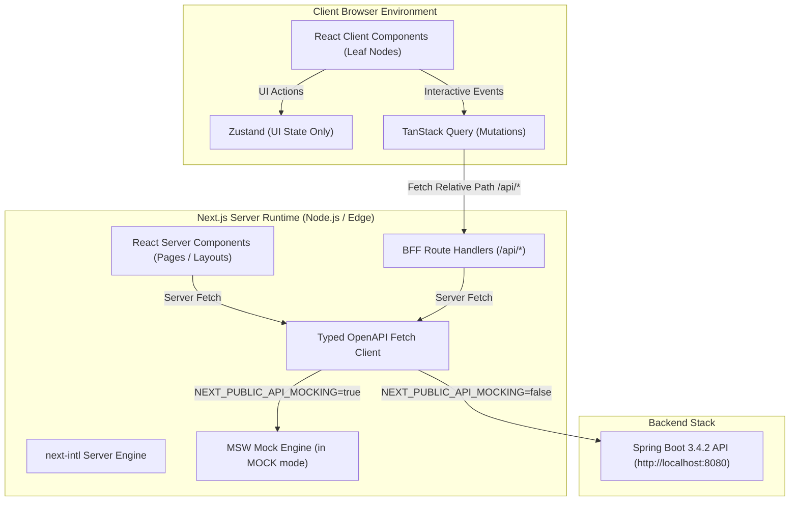
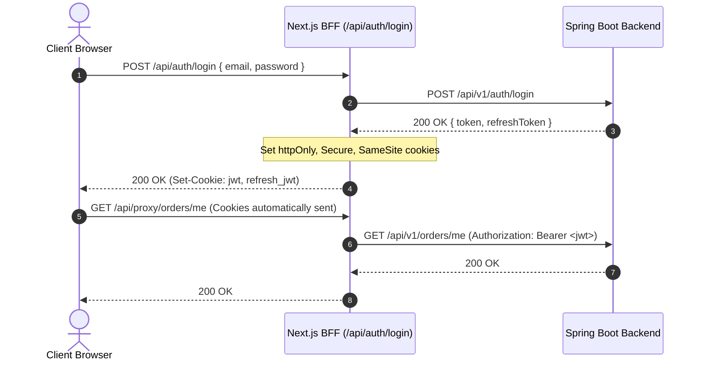

# ClassicStore Frontend System Architecture

This document outlines the architectural blueprints, directory layout, data flow, rendering policies, and configuration settings for the Next.js storefront application (`/frontend`).

---

## 1. Directory Tree Blueprint (`/frontend`)

The Next.js 15 App Router codebase will be structured following the feature-based modular pattern established in ADR-010:

```
frontend/
├── .env.example
├── .env.local
├── next.config.ts
├── package.json
├── postcss.config.mjs
├── tsconfig.json
├── public/
│   ├── assets/
│   │   ├── images/
│   │   └── icons/
│   └── favicon.ico
├── messages/                   # i18n Translation Dictionaries (ADR-005)
│   ├── ar.json
│   └── en.json
└── src/
    ├── app/                    # Next.js App Router (Routing Layer)
    │   ├── [locale]/
    │   │   ├── (storefront)/   # SSG / ISR Public Storefront Layout Group
    │   │   │   ├── page.tsx    # Home Page
    │   │   │   ├── products/
    │   │   │   │   ├── page.tsx          # Catalog / Search Page
    │   │   │   │   └── [slug]/page.tsx   # Product Details Page
    │   │   │   ├── cart/page.tsx         # Cart Drawer / Full Page
    │   │   │   └── checkout/page.tsx     # Checkout Flow
    │   │   ├── (auth)/         # Authentication Layout Group
    │   │   │   ├── login/page.tsx
    │   │   │   └── register/page.tsx
    │   │   ├── account/        # Authenticated Customer Account
    │   │   │   ├── page.tsx              # Orders Overview
    │   │   │   └── addresses/page.tsx    # Saved Addresses
    │   │   ├── admin/          # Backoffice Admin Management
    │   │   │   ├── products/page.tsx
    │   │   │   └── orders/page.tsx
    │   │   └── layout.tsx      # Root Locale Layout (HTML dir, Fonts, i18n)
    │   └── api/                # Next.js BFF Route Handlers (ADR-004)
    │       ├── auth/
    │       │   ├── login/route.ts
    │       │   ├── refresh/route.ts
    │       │   └── logout/route.ts
    │       └── proxy/[...path]/route.ts  # CORS Bypass Proxy (GAP-01)
    ├── features/               # Feature-Based Modules (ADR-010)
    │   ├── catalog/
    │   │   ├── api/            # Server fetchers & query hooks
    │   │   ├── components/     # ProductCard, ProductGrid, Gallery
    │   │   └── types/
    │   ├── cart/
    │   ├── checkout/
    │   ├── auth/
    │   ├── account/
    │   └── admin/
    └── shared/                 # Generic Shared UI & Utilities
        ├── components/ui/      # Primitive UI components (Button, Input, Modal)
        ├── hooks/              # Generic React hooks
        ├── lib/
        │   ├── api/            # Generated openapi-fetch client
        │   ├── mocks/          # MSW handlers & fixtures (ADR-007)
        │   │   ├── handlers.ts
        │   │   └── planned/    # Missing schema mocks (GAP-03, GAP-04)
        │   ├── i18n/           # next-intl configuration
        │   └── formatters/     # Money & number formatters (ADR-009)
        ├── store/              # Zustand global UI state (ADR-003)
        └── styles/             # Design token CSS variables (ADR-006)
```

---

## 2. Layer Architecture & Data Flow Diagrams

### System Layer Architecture



### Authentication Data Flow (BFF Cookie Architecture)



---

## 3. Route Rendering Strategy & Cache Policy Matrix

| Route Path | Localized URL | Rendering Mode | Cache Policy | Revalidation Strategy | SEO Indexing |
| :--- | :--- | :--- | :--- | :--- | :--- |
| Home | `/[locale]` | **ISR / SSG** | `s-maxage=3600` | Tag: `home`, 1 Hour | `index, follow` |
| Product Catalog | `/[locale]/products` | **ISR / SSG** | `s-maxage=600` | Tag: `products`, 10 Mins | `index, follow` |
| Product Details | `/[locale]/products/[slug]` | **ISR / SSG** | `s-maxage=3600` | Tag: `product-[slug]` | `index, follow` |
| Cart | `/[locale]/cart` | **Dynamic** | `no-store` | Private / Dynamic | `noindex, nofollow` |
| Checkout | `/[locale]/checkout` | **Dynamic** | `no-store` | Private / Dynamic | `noindex, nofollow` |
| Auth Pages | `/[locale]/login` | **Dynamic** | `no-store` | Private / Dynamic | `noindex, nofollow` |
| Customer Account | `/[locale]/account/*` | **Dynamic** | `no-store` | Private / Dynamic | `noindex, nofollow` |
| Admin Dashboard | `/[locale]/admin/*` | **Dynamic** | `no-store` | Private / Dynamic | `noindex, nofollow` |

---

## 4. Environment Configuration Variables

Environment configuration settings are defined without hard-coding secrets:

| Variable Name | Type | Description | Default / Example |
| :--- | :--- | :--- | :--- |
| `NEXT_PUBLIC_API_BASE_URL` | String | Public backend URL for proxy | `http://localhost:8080/api/v1` |
| `NEXT_PUBLIC_API_MOCKING` | Boolean | Toggles MSW mocking engine | `true` (dev) / `false` (prod) |
| `NEXT_PUBLIC_DEFAULT_LOCALE` | String | Fallback default language | `ar` |
| `NEXT_PUBLIC_SITE_URL` | String | Canonical site URL for SEO | `http://localhost:3000` |
| `SESSION_SECRET` | String | Server-side cookie encryption key | Set via environment secret |

---

## 5. Mock vs Real Backend Switching Mechanism

Switching between the Mock Service Worker (MSW) engine and the real Java Spring Boot backend is seamlessly controlled via `NEXT_PUBLIC_API_MOCKING`:

1. **Mock Mode (`NEXT_PUBLIC_API_MOCKING=true`)**:
   - In browser: MSW service worker (`mockServiceWorker.js`) intercepts relative `/api/*` fetch requests and returns typed mock data.
   - On server: Node MSW server intercepts server-side fetch requests during Server Component rendering.

2. **Real Mode (`NEXT_PUBLIC_API_MOCKING=false`)**:
   - MSW initialization is completely skipped.
   - Next.js BFF route handler forwards `/api/proxy/*` requests directly to `NEXT_PUBLIC_API_BASE_URL` on Spring Boot (`http://localhost:8080/api/v1`).
